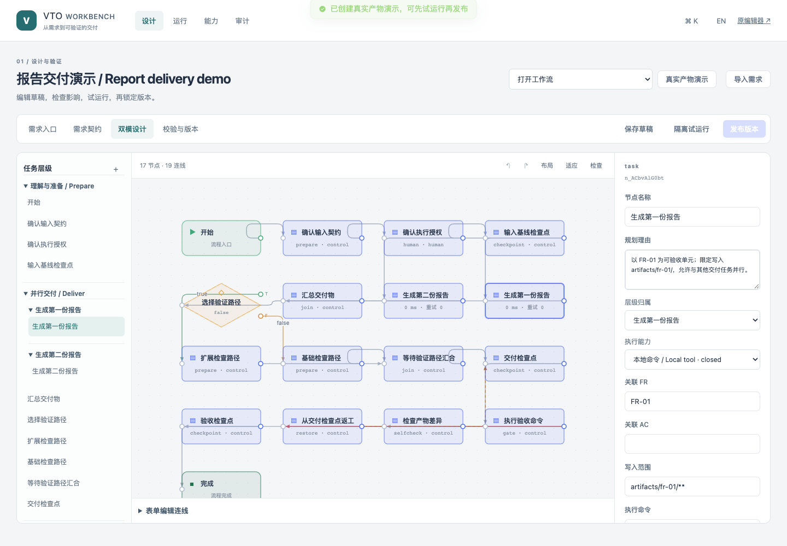
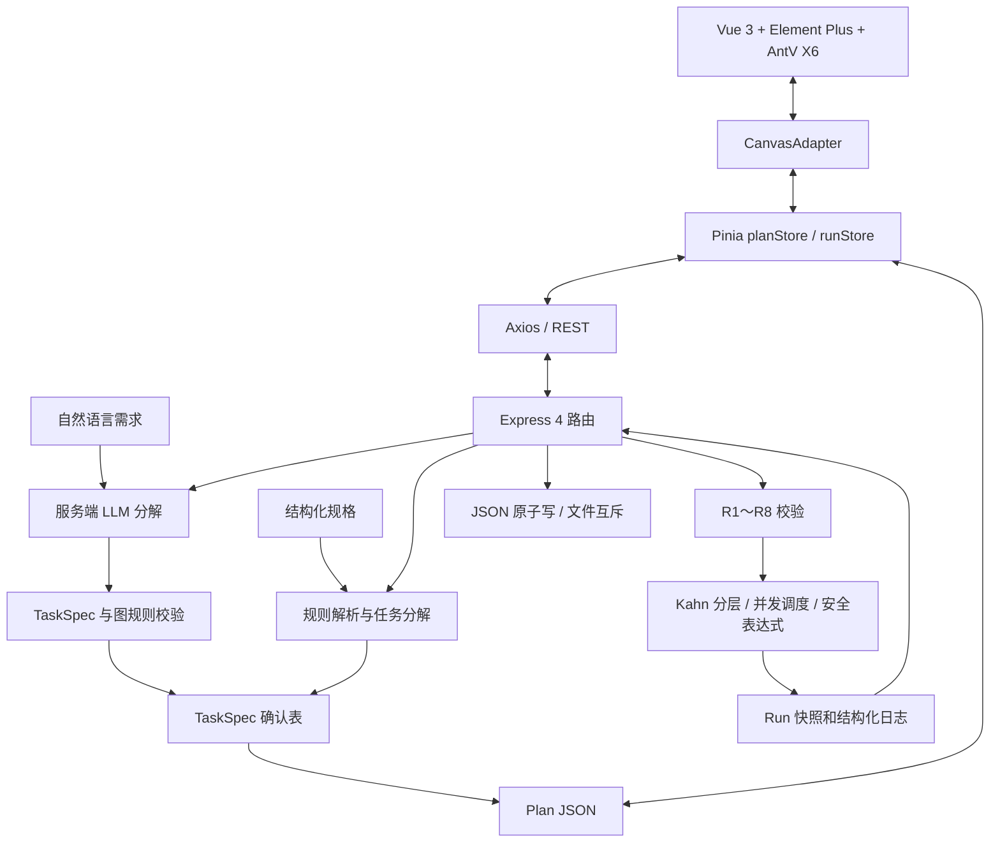

# VTO 可视化任务编排器

把确认的需求转换为可编辑的层级任务与执行图，经过校验、隔离试运行和版本发布后，在独立 Git worktree 中执行并导出证据。保留原课程版模拟编辑器；完整工作台位于 `/#workbench`。规则提取和真实本地工具演示可离线运行，模型调用需要配置服务。

基于用户提供的《可视化任务编排器课程设计说明书》V1.0 实现。完整原文见 [设计说明书](docs/设计说明书原文.md)，消歧与实现细节见 [实现约定](docs/实现约定.md)。

> **已确认的规格修订：** 说明书 start 单出边规则与附录 A 的 start 双出边矛盾。用户确认严格单出边，运行示例增加一个耗时 0ms 的普通分流任务，因此是 **11 节点、12 条边**。分解器仍精确输出 6.5 的 9 条任务清单；原始 10 节点、11 边图保留作对照。


## 两条命令启动

要求 Node.js ≥18、npm；真实工作区执行需要 Git。首次安装依赖需要网络。安装后，规则提取、原模拟编辑器及真实本地产物演示可离线运行；AI 分解和模型执行需要访问已配置服务。

```bash
npm ci
npm run dev
```

访问 **http://localhost:5173/#workbench** 使用完整工作台；访问根路径使用原编辑器。根脚本同时启动 Express **3000** 和 Vite **5173**，Vite 将 `/api` 代理到后端。按 Ctrl+C 停止两进程。

也可以严格按说明书在两个终端分别启动：

```bash
# 终端一，在仓库根目录执行
cd backend && npm install && npm run dev
```

```bash
# 终端二，在仓库根目录执行
cd frontend && npm install && npm run dev
```

首次演示：点击「载入示例」→「执行编排」。完整规格演示：点击「导入规格」→「填入登录示例」→「开始分解」→ 编辑清单 →「确认并生成画布」。

生产构建可由后端直接提供静态页面：

```bash
npm run build
npm start --workspace backend
# 访问 http://localhost:3000
```

## 自然语言 AI 分解

在部署或验收环境的仓库根目录复制配置模板：

```bash
cp .env.example .env
```

填写 `LLM_API_KEY`、`LLM_BASE_URL`、`LLM_MODEL` 后启动或重启后端。Key 只保存在服务端环境或根目录 `.env`，不要放入 `VITE_` 变量或提交到 Git。

| 变量 | 含义 |
| --- | --- |
| `LLM_API_KEY` | 模型服务的 API Key，必填 |
| `LLM_BASE_URL` | Chat Completions 兼容 API 的根地址，包含服务商要求的版本路径；程序追加 `/chat/completions` |
| `LLM_MODEL` | 服务商提供的确切模型名称，必填 |

配置文件按仓库根目录定位，不受从根目录还是 `backend/` 启动影响；已设置的进程环境变量优先。远程服务使用 HTTPS，本机回环地址可使用 HTTP。地址不应包含用户名、密码、查询参数或片段，也不要填完整的 `/chat/completions` 请求路径。

使用步骤：打开「导入规格」→ 选择「自然语言」→ 输入需求 →「AI 分解」→ 在原有确认表中编辑任务与依赖 →「确认并生成画布」→「执行编排」。例如：

> 帮我做一个登录功能，用户能输入账号密码，后端要校验，成功跳转首页，失败提示错误。

需求文本会发送给你配置的模型服务。返回结果经过 JSON、TaskSpec 依赖结构和现有图规则校验后，才进入确认表。两条入口共用同一确认表和执行流程；模型不会直接保存方案或执行任务。

未配置时，AI 按钮显示不可用及具体原因，原有规则分解照常使用。配置状态检查不调用模型，也不产生模型请求费用；`enabled: true` 仅表示本地配置完整，不能保证密钥、余额或模型服务当前可用。单次分解有超时和响应大小限制，不自动重试付费请求。

模型生成的“账号密码校验”“跳转首页”是编排中的模拟任务，不会真正开发登录系统或发起业务 HTTP 请求。条件输出遵循原执行器语义：任务成功时把 `output` 变量设为 `true`。AI 响应保留既有 `detectedFormat: "numbered"`，表示生成的编号结构；界面显示「AI 分解结果」，不会声称原自然语言属于编号格式。

配置、错误排查及完整验收步骤见 [自然语言验收](docs/自然语言验收.md)。

## 功能

完整工作台入口：`/#workbench`。原编辑器入口：`/` 或 `/#legacy`，原始课程示例、五种节点和快捷键继续可用。

- **需求契约**：Markdown / 自然语言提取 GoalSpec，包含 FR、AC、输入、输出、约束、模块和来源；模型结果的来源由服务端核对，补充内容标为 suggested，支持人工确认与编辑。
- **规划和双图**：Phase → Task → Subtask 共享节点标识，带规划理由、需求映射、输入输出契约；提供模板、并行分支、条件路由、汇合、检查点和有界返工边。
- **统一校验**：新增语义纳入 R1～R8，按结构、需求契约、能力策略分层，以 Error / Warning / Info 定位；普通循环仍拒绝。并行写范围冲突、能力熔断、人工门禁顺序和 DDD 别名可检查。
- **草稿与发布**：表单、树和 X6 画布联动；变更影响分析；隔离试运行报告绑定草稿摘要；不可变 v1.0/v2.0 快照。每次新运行绑定发布版本，编辑草稿不改变活动运行。
- **真实执行**：本地命令、OpenAI-compatible / Anthropic API、CLI 输出及 ACP 会话适配；支持能力池、配置探测、健康/熔断、角色和提示词配置。原模拟任务、失败注入和退避重试保留。
- **运行控制**：共享资源槽、条件 skipped、Join、暂停/恢复/取消、失败节点重试、人工批准/拒绝/豁免及运行期 GhostNode。返工达到上限转人工，批准只追加一次额度。
- **工作区与恢复**：每次运行独立 Git worktree；检查点保存引擎状态和 Git 引用；恢复先保留救援引用及旧目录，再创建新 worktree，不改写既有分支历史。
- **验收证据**：实际命令退出码、产物类型/文件核验、diff 自检及只读 QA；会话、尝试、审批和恢复记录通过增量轮询读取；支持搜索和带校验摘要的 evidence JSON 导出。
- **管理与界面**：浅色中英工作台、设计/运行/能力/审计分区、命令面板、MCP 服务登记与真实连通性探测、DDD 术语、工程命令规则、Token/缓存/费用估算和环境 Doctor。
- **输出**：Markdown WBS、Mermaid、Plan JSON 导出；三个原创需求示例；可分发的浏览器运行包。

最快演示：**真实产物演示 → 隔离试运行 → 发布版本 → 运行选定版本 → 填写理由并批准 → 观察首次门禁失败及自动返工 → 导出证据**。该流程实际创建文件并运行验证脚本，不需要商业模型 Key。

逐项实现、参考位置、测试及排除理由见 [功能对照表](docs/功能对照表.md)；操作步骤见 [功能验收手册](docs/功能验收手册.md)。

原编辑器继续支持 `⌘/Ctrl S` 保存、撤销重做、复制粘贴、Delete、20px 吸附、真实端口连线、自动布局、折叠侧栏、导入导出、草稿与运行恢复。完整工作台使用 `⌘/Ctrl K` 打开导航面板。



## 架构



```text
backend/
  server.js                 Express 入口，端口 3000
  routes/                   原有 REST 接口及自然语言并行入口
  config/                   服务端模型环境配置
  services/                 planService、runService、原子存储与 LLM 分解
  engine/                   decomposer、validator、scheduler、expression
  storage/                  运行时生成，Git 忽略
frontend/
  src/stores/               Pinia 状态与草稿恢复
  src/adapter/              X6 画布与数据双向同步
  src/components/           确认表、属性与日志组件
  src/views/                五区编辑器
shared/                     共享契约、颜色、画布转换与布局
examples/                   规格、TaskSpec、原始附录图与修正运行图
tests/                      Vitest 单元与接口测试
  e2e/                      Playwright 浏览器验收
scripts/                    联合启动脚本
docs/                       契约、实现约定、测试报告、演示材料
```

版本范围遵守说明书：Vue 3、Element Plus 2、X6 2、Pinia 2、Axios 1、Express 4、Vitest 1。Vite 5 与 TypeScript 5 由锁文件固定。执行引擎不依赖任何前端模块。

## 测试与验收

每次模块推送前均执行以下四项，全部成功才推送功能分支：

```bash
npm ci
npm test
npm run build
npm run test:e2e
```

原有 **225 项 Vitest 与 17 项 Playwright** 均保留。本次最终通过 **389 项 Vitest、26 项 Playwright**（新增 164 / 9）。通过时间和日志摘要见 [最终验收报告](docs/parity/最终验收报告.md)，各模块记录在 `docs/parity/M*-验收.md`。TypeScript 检查包含在 build 中。

Playwright 自动启动隔离的回环测试服务，模型请求使用本地协议替身，存储使用临时目录；不读取真实 API Key。新增验证覆盖完整工作台的来源确认、节点/画布联动、发布、人工控制、Ghost、真实产物与返工、版本隔离、手动恢复、MCP/DDD、搜索及导出。真实 Git、Node 子进程和 HTTP 传输在测试中实际运行。

商业供应商和第三方 CLI/ACP 的真实授权环境未在本次验收中配置；协议替身通过不能替代供应商联调。内置演示真实验证的是示例产物及编排链路，不声称已经完成任意用户业务系统。

### Web 分发包

```bash
npm run package:web -- /absolute/path/to/new-bundle
cd /absolute/path/to/new-bundle
node start.mjs
```

目标目录必须不存在。打包包含已构建前端与 Node 运行依赖，不包含密钥、用户运行数据或 Electron。接收方仍需要 Node 与 Git；可用 `PORT`、`VTO_DATA_DIR` 指定端口和数据目录。macOS 上已实测独立目录启动与完整真实产物恢复链路；其他操作系统未进行实机验收。

## API 与数据

| 方法 | 路径 | 返回 |
| --- | --- | --- |
| POST | `/api/decompose` | `{ok:true, taskSpec}`，规则分解 |
| POST | `/api/decompose-nl` | `{ok:true, taskSpec}`，自然语言 AI 分解 |
| GET | `/api/decompose-nl/status` | `{enabled:true}` 或 `{enabled:false,code,message}`，仅查本地配置 |
| POST | `/api/plans` | `{id, updatedAt}` |
| GET | `/api/plans` | 方案索引数组 |
| GET / DELETE | `/api/plans/:id` | 完整方案 / `{ok:true}` |
| POST | `/api/plans/:id/execute` | `{runId}` |
| GET | `/api/runs/:runId?since=seq` | 完整节点状态与增量日志 |
| POST | `/api/runs/:runId/cancel` | `{status:"CANCELED"}` |

成功均返回 HTTP 200。业务错误为 `{code,message,details?}`，原接口使用 40001、40002、40003、40401、40402、40901、50000。自然语言入口额外使用 50301（未配置）、50201（上游请求失败）、50401（超时）；模型返回非法 JSON 或不合法 TaskSpec 使用 40001，并说明出错字段。保存允许结构合法但尚未连完的草稿；执行前完成全量语义校验。导入及加载也执行 Schema 校验。

`backend/storage/plans/index.json` 保存索引，`plans/<id>.json` 保存草稿，`versions/<planId>/<versionId>.json` 保存不可变发布快照，`runs/<id>.json` 保存运行状态、会话、尝试和事件。`audit-ledger.json` 保存设计审计，`providers.json` 保存服务端模型配置。数据目录可通过 `VTO_DATA_DIR` 指定。写入流程为同目录临时文件、flush、rename，并按文件串行化。索引可从方案文件重建。不要直接修改正在执行的运行快照。

服务重启不会自动重放外部动作；读取之前未完成的运行时标记 FAILED 并说明中断。浏览器刷新可恢复同一服务进程内的活动运行。对具有持久化图与检查点的运行，可显式恢复检查点；需要重新执行的失败节点可手动重试。

## 运行边界

- 面向单用户本机编排，100 个执行节点、200 条边；多层容器是 WBS 元数据。原数据格式 `version: "1.0"` 与工作流发布 `versionTag: "v1.0"` 分开，旧数据保持兼容。
- 默认服务仅监听 `127.0.0.1`。完整工作流执行和管理接口需要本机会话；原模拟 API 保留课程契约。不是公网多租户服务，未实现账户、RBAC 和多人协作。
- 模拟、真实工具和模型执行均明确标识。自然语言提取需要模型配置；本地规则及产物演示可离线。模型输出经契约验证，不能把建议当作文档事实。
- 文件工具检查 worktree 边界、符号链接与 `.git` 路径；命令按参数启动、限制时间和输出，工程禁止规则实时生效。**这些约束不是操作系统级强沙箱**。外部命令与 CLI 应来自可信配置，不能把任意恶意程序放入后便声称无法越界。
- 恢复保留旧工作区及救援引用；被 Git 忽略的文件留在旧目录，不自动复制到新工作区。外部项目依赖安装由项目任务配置负责。Doctor 仅清理失效 worktree 登记，不自动删除有效产物。
- 试运行模拟控制流，真实执行门禁实际运行命令。扩展检查只核对产物范围和敏感文件名，不是漏洞扫描器。独立 QA 需要已通过的真实命令及配置的只读模型能力，非法输出按失败处理。
- MCP 池提供登记与 HTTP 连通性/stdio 程序存在检查；不宣称已经完成通用 MCP 工具握手或调用。
- 成本按供应商 usage 和配置费率估算；缓存输入不重复计算，缺少 usage 或费率显示未知。预算是提示线，不保证供应商账单硬限额。
- JSON 按文件互斥并原子发布；单进程使用，不提供数据库级跨进程事务。证据摘要用于一致性核对，不是数字签名或管理员防篡改证明。单会话最多 2MB/2000 条消息，截断有标识。
- **有意不做**：上游需求讨论/HAMA、通用知识库/SkillsBank、Dreaming/认知巩固/自演化守护。参考当前 main 已含部分这些功能，本项目按已批准边界排除，从已确认需求开始。
- **技术替代**：保留 Vue 3、Element Plus 2、X6 2、Pinia 2、Axios 1、Express 4、Vitest 1、Vite 5、TypeScript 5；无 Electron；SQLite WAL/FTS5 用现有 JSON 存储与搜索替代，SSE 用增量轮询替代。

完整路由与验收入口见 [功能验收手册](docs/功能验收手册.md)。历史课程版材料保留在 docs 中，当前功能与结果以上述报告为准。
