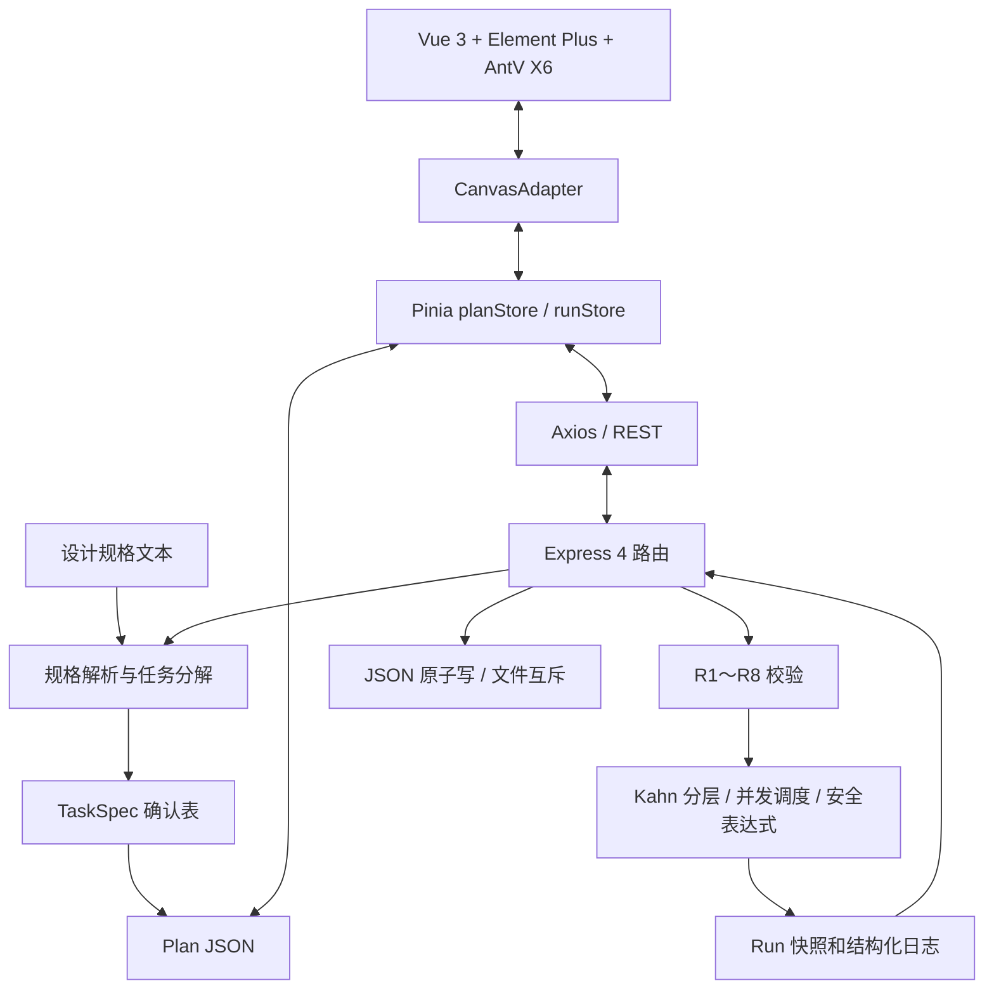

# VTO 可视化任务编排器

把设计规格转换为任务清单，在画布上编辑依赖，然后观察并行、条件路由、失败重试和执行日志。面向单用户课程演示，全部任务为本地模拟执行，无需外部服务或 API Key。

基于用户提供的《可视化任务编排器课程设计说明书》V1.0 实现。完整原文见 [设计说明书](docs/设计说明书原文.md)，消歧与实现细节见 [实现约定](docs/实现约定.md)。

> **已确认的规格修订：** 说明书 start 单出边规则与附录 A 的 start 双出边矛盾。用户确认严格单出边，运行示例增加一个耗时 0ms 的普通分流任务，因此是 **11 节点、12 条边**。分解器仍精确输出 6.5 的 9 条任务清单；原始 10 节点、11 边图保留作对照。


## 两条命令启动

要求 Node.js ≥18 与 npm。首次安装依赖需要网络，之后运行不需要外网。

```bash
npm ci
npm run dev
```

访问 **http://localhost:5173**。根脚本同时启动 Express **3000** 和 Vite **5173**，Vite 将 `/api` 代理到后端。按 Ctrl+C 停止两进程。

也可以严格按说明书在两个终端分别启动：

```bash
# 终端一，在仓库根目录执行
cd backend && npm install && npm run dev
```

```bash
# 终端二，在仓库根目录执行
cd frontend && npm install && npm run dev
```

首次演示：点击「载入示例」→「执行编排」。完整规格演示：点击「导入规格」→「填入登录示例」→「开始分解」→ 编辑清单 →「确认并生成画布」。

生产构建可由后端直接提供静态页面：

```bash
npm run build
npm start --workspace backend
# 访问 http://localhost:3000
```

## 功能

- Markdown `#`～`####`、中文编号及数字编号结构识别，UTF-8 200KB 限制，`.md` / `.txt` 上传。
- 清洗、结构树、关键词规则和依赖推断，支持同级并行、父子依赖、条件分支后缀绑定。
- 两步确认表：勾选、改名、改类型、增删、编辑依赖和分支。移除任务时保留依赖接续。
- 五类节点、浅色点阵画布、可折叠左右侧栏、属性面板、日志图例与进度条。
- 拖拽创建、20px 吸附、端口连线、非法连接 Toast、框选、删除、复制粘贴、撤销重做、缩放平移与自动布局。
- 服务端 R1～R8 校验，错误清单按节点定位；未通过校验不会执行任何节点。
- 最大并发数、受限表达式、true/false 路由、AND-Join、失败注入、500ms×attempt 退避重试、停止与 continueOnError。
- 每 500ms 增量轮询，状态颜色与图例共用同一份常量，失败日志突出显示。
- JSON 原子存储、方案列表、导入导出、自动草稿恢复及按方案恢复最近运行记录。
- 附录对照数据、可执行示例、Vitest 测试、浏览器测试、验收报告和 7 分 30 秒课堂演示 PPT。

快捷键：`⌘/Ctrl S` 保存，`⌘/Ctrl Z` 撤销，`⌘/Ctrl Shift Z` / `Ctrl Y` 重做，`⌘/Ctrl C/V` 复制粘贴，`Delete` 删除，`Shift` 拖动框选，右键拖动画布，`⌘/Ctrl` 加滚轮缩放，`F` 适应画布。输入表单时快捷键不会误删节点。

## 架构



```text
backend/
  server.js                 Express 入口，端口 3000
  routes/                   严格遵循 6.7 的 REST 接口
  services/                 planService、runService、原子存储
  engine/                   decomposer、validator、scheduler、expression
  storage/                  运行时生成，Git 忽略
frontend/
  src/stores/               Pinia 状态与草稿恢复
  src/adapter/              X6 画布与数据双向同步
  src/components/           确认表、属性与日志组件
  src/views/                五区编辑器
shared/                     共享契约、颜色、画布转换与布局
examples/                   规格、TaskSpec、原始附录图与修正运行图
tests/                      Vitest 单元与接口测试
  e2e/                      Playwright 浏览器验收
scripts/                    联合启动脚本
docs/                       契约、实现约定、测试报告、演示材料
```

版本范围遵守说明书：Vue 3、Element Plus 2、X6 2、Pinia 2、Axios 1、Express 4、Vitest 1。Vite 5 与 TypeScript 5 由锁文件固定。执行引擎不依赖任何前端模块。

## 测试与验收

```bash
npm test             # 分解器、图校验、调度、表达式、存储、REST、画布转换
npm run build        # TypeScript 检查和生产构建
```

浏览器自动测试需要本机 Chrome，先保持 `npm run dev` 运行，再在另一终端执行：

```bash
npm run test:e2e
```

测试配置用独立临时浏览器上下文，不读取个人浏览器数据。浏览器测试会在当前本地后端创建测试方案并在结束后删除；单元/接口存储测试使用操作系统临时目录。

验收证据见 [测试报告](docs/测试报告.md)，逐项人工步骤与时间安排见 [演示流程](docs/演示流程.md)，课堂讲义见 [演示 PPT](docs/演示讲义.pptx)。

## API 与数据

| 方法 | 路径 | 返回 |
| --- | --- | --- |
| POST | `/api/decompose` | `{ok:true, taskSpec}` |
| POST | `/api/plans` | `{id, updatedAt}` |
| GET | `/api/plans` | 方案索引数组 |
| GET / DELETE | `/api/plans/:id` | 完整方案 / `{ok:true}` |
| POST | `/api/plans/:id/execute` | `{runId}` |
| GET | `/api/runs/:runId?since=seq` | 完整节点状态与增量日志 |
| POST | `/api/runs/:runId/cancel` | `{status:"CANCELED"}` |

成功均返回 HTTP 200。业务错误为 `{code,message,details?}`，使用 40001、40002、40003、40401、40402、40901、50000。保存允许结构合法但尚未连完的草稿；执行前完成全量语义校验。导入及加载也执行 Schema 校验。

`backend/storage/plans/index.json` 保存索引，`plans/<id>.json` 保存方案，`runs/<id>.json` 保存快照。写入流程为同目录临时文件、flush、rename，并按文件串行化。索引可从方案文件重建。不要直接修改正在执行的运行快照。

服务重启不会恢复计时器；之前未完成的运行会标记 FAILED 并写明中断原因。浏览器刷新可恢复仍在同一后端执行的运行。

## 运行边界

100 节点、200 边以内；只支持五种既定节点；无真实脚本执行、外部 HTTP 任务、多人协作或云端服务。条件表达式通过 tokenizer 与递归下降解析器求值，支持比较、逻辑、括号、变量与字面量，不允许函数调用和赋值。

若端口已占用，请先停止旧的本项目服务。若存储文件损坏，界面会显示错误；恢复备份后重新加载，不会默默覆盖坏数据。长流程可收起侧栏、日志或放大画布查看节点文字。
