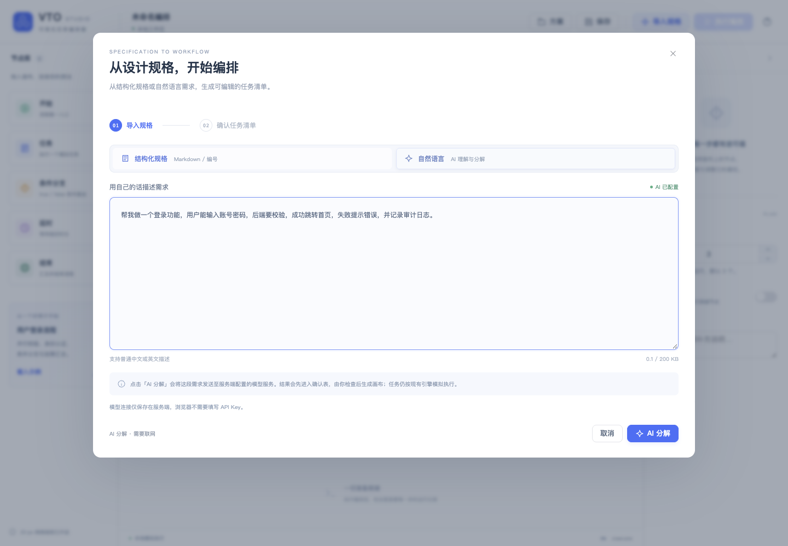
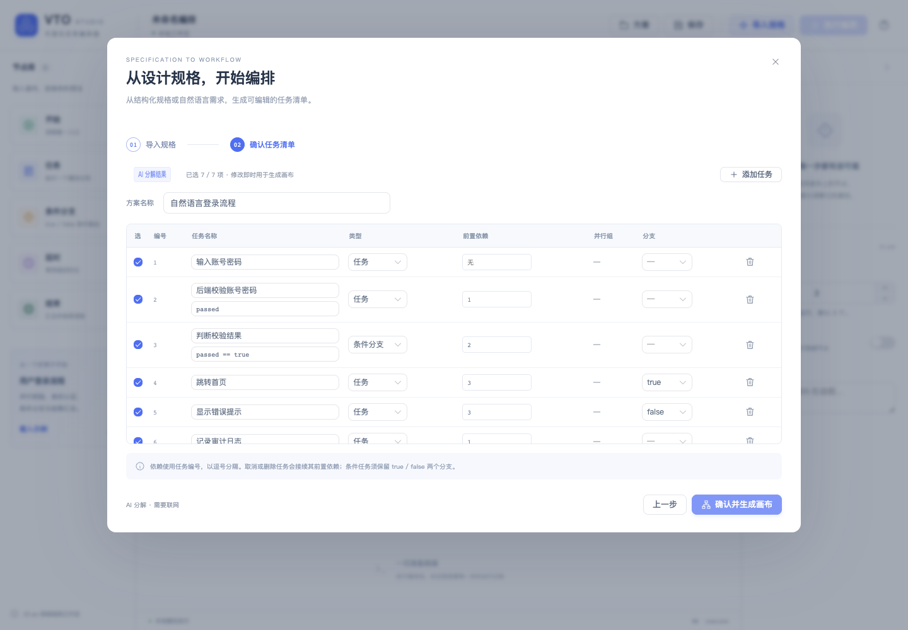

# 自然语言分解扩展验收

本扩展增加“自然语言需求 → AI 分解 → 现有确认表 → 画布 → 模拟执行”入口。原 Markdown/编号规则分解器保持不变。本文件描述配置、验收步骤和证据要求，不把待执行步骤视为通过结果。

## 验收状态

| 项目 | 当前记录 |
| --- | --- |
| 测试日期与环境 | 2026-11-17（Asia/Shanghai），macOS、Chrome、隔离回环测试服务 |
| Vitest 单元与接口 | `npm test`：225 项通过，含原有 130 项与新增 95 项 |
| TypeScript 与生产构建 | `npm run build` 成功。仅有既有 Element Plus vendor 约 955.79KB 的体积提示 |
| 浏览器全流程 | `npm run test:e2e`：17 项通过，含原有 9 项与新增 8 项；包括真实 HTTP 模型协议替身链路 |
| 运行方式 | 仅验收临时运行，使用 Playwright 自动启动/关闭的隔离服务，不要求手动运行开发服务 |
| 真实模型服务联调 | 尚未配置实际供应商、模型和密钥，未执行，不宣称已通过 |

课程版历史测试结果保留在 `测试报告.md`，本文件记录自然语言扩展后的本轮全量回归。新增测试覆盖 TaskSpec 字段和依赖、模型环境配置、响应解析与语义检查、接口错误码、未配置降级、对话框取消和完整执行链路。

## 自动化复现

```bash
npm ci
npm test
npm run build
npm run test:e2e
```

`npm run test:e2e` 自带构建步骤，无需先启动 `npm run dev`。本机需安装 Chrome；CI 设置下使用 Playwright Chromium。`tests/support/start-e2e.mjs` 提供隔离环境：

- 真实前端生产构建及 Express API 仅监听 `127.0.0.1:4173`。
- Chat Completions 协议替身监听随机回环端口，检查请求路径、模型名、消息结构及测试用鉴权值。
- 后端显式注入测试配置，不加载仓库 `.env`，不读取真实密钥，不访问外部模型服务。
- JSON 数据使用系统临时目录，测试浏览器使用独立上下文，不读取个人浏览器资料。
- 测试结束后 Playwright 发送 SIGTERM，关闭应用、模型替身及未完成模拟任务，并删除临时数据；不会留下常驻开发服务。

`natural-language-http.spec.js` 不拦截 `/api/decompose-nl` 的响应，实际经过浏览器、Express 新路由、模型服务 HTTP 请求、JSON/TaskSpec/图校验、共用确认表、依赖编辑、画布与执行引擎，最终成功并核对跳过分支和日志。其模型端仍是确定性测试替身，不是外部供应商。

## 配置和状态

1. 在运行环境的仓库根目录复制 `.env.example` 为 `.env`。
2. 配置 `LLM_API_KEY`、`LLM_BASE_URL`、`LLM_MODEL`。不要在聊天、截图或提交中展示真实 Key。
3. Base URL 使用兼容 Chat Completions 的 API 根地址，保留服务商要求的版本路径。程序追加 `/chat/completions`，不要重复填写该后缀。
4. 启动或重启后端。根目录和 `backend/` 两种启动方式均读取仓库根 `.env`；进程环境变量优先。
5. 查询 `GET /api/decompose-nl/status`。已配置返回 `{enabled:true}`；未配置返回 `{enabled:false,code:50301,message:"..."}`，不向浏览器返回 Key 或服务完整配置。

状态查询只做本地配置检查，不调用模型。`enabled:true` 不等于 Key 鉴权、模型名称、额度或服务网络已经验证。

## 接口契约

```http
POST /api/decompose-nl
Content-Type: application/json
```

```json
{
  "text": "帮我做一个登录功能，用户能输入账号密码，后端要校验，成功跳转首页，失败提示错误"
}
```

成功返回 HTTP 200 和 `{ "ok": true, "taskSpec": { ... } }`，TaskSpec 沿用 `source/detectedFormat/tasks`。任务使用 `key/name/type/dependsOn`，不会转换成 `id/title/dependencies`。

AI 的 `detectedFormat` 为 `numbered`，表示生成的编号任务结构；界面使用独立来源状态显示“AI 分解结果”。依赖引用任务 key，分支为字符串 `"true"` 或 `"false"`，不是布尔值。

| HTTP | code | 说明 | 处理方式 |
| --- | --- | --- | --- |
| 400 | 40001 | 输入非法，或 AI 返回非 JSON、错误字段、错误依赖或无法执行的图 | 查看可读消息与字段定位，修正需求后重新请求 |
| 503 | 50301 | 模型配置缺失或不合法 | 完善服务端环境配置并重启，规则入口照常工作 |
| 502 | 50201 | 模型鉴权、限流、网络或上游协议错误 | 核对供应商 Key、模型名、额度与服务状态 |
| 504 | 50401 | 模型请求超时 | 稍后手动重试，或精简需求 |
| 500 | 50000 | 未预期的内部错误 | 保留复现步骤，检查服务端运行环境 |

模型响应必须先通过严格 JSON、TaskSpec 字段/依赖校验，以及现有 Plan 转换和 R1～R8 检查。成功返回前不保存方案或启动任务。模型请求不会自动重试。

## 正向全流程

用户已允许仅为验收临时运行项目。按下面操作验收，完成后立即停止本次启动的服务；不留下常驻开发进程。

1. 打开「导入规格」，选择「自然语言」。确认配置就绪后 AI 按钮可用，并显示需求将发送到配置模型服务的说明。
2. 输入上面的登录需求，点击「AI 分解」。等待期间显示加载状态，不允许重复提交。
3. 成功后进入原有第二步确认表。应能看到任务名称、类型、依赖、并行组、分支；条件行还应显示表达式。
4. 修改一个普通任务名称，并调整一个合法的前置依赖。确认表格使用的是 `key` 引用，保留两条条件分支及其汇聚。
5. 点击「确认并生成画布」。检查名称和依赖与编辑后的表格一致，只有既定五类节点，开始节点只有一条出边，布局无重叠。
6. 点击「执行编排」。任务按依赖执行，条件正确选路，未激活分支跳过，日志与节点状态一致。
7. 保存后刷新，重新打开方案。画布与执行结果按原流程恢复。
8. 回到结构化规格入口，粘贴 `examples/login-spec.md`，完成规则分解和执行，确认旧路径未受影响。

自然语言需求可能产生多种合理拆解，不以某一固定任务数量作为真实模型验收标准。判断依据是需求覆盖、结构合法、依赖合理及完整流程可执行。示例中的“登录”“跳转”仅是模拟节点，不会真正实现业务登录系统。

## 负向与竞争场景

| 场景 | 预期 |
| --- | --- |
| 不配置 API Key | 后端正常启动；状态接口说明缺配置；AI 按钮禁用；规则分解正常 |
| 空文本、非字符串、超过 200KB | 明确请求错误，不发起模型调用 |
| 模型返回代码块、非 JSON 或截断内容 | 40001，可读格式错误；不进入确认表 |
| 字段名称错误或未知字段 | 40001，指出字段问题 |
| 依赖不存在、重复 key、自依赖或有环 | 40001；不会保存或执行节点 |
| condition 缺表达式、分支不完整或不汇聚 | 40001；不返回误导性的成功结果 |
| 条件引用不存在的输出变量 | 40001，指出条件变量来源问题 |
| 模型认证失败或限流 | 50201，前端显示可读提示，规则入口仍可用 |
| 模型响应超时或超过大小限制 | 请求受限并明确失败，不无限等待 |
| 请求过程中关闭对话框或切换入口 | 请求取消；旧响应不会覆盖新输入或跳转确认表 |
| AI 请求完成后再编辑确认表 | 改动影响最终画布，模型原结果不覆盖人工编辑 |
| 服务配置状态请求失败 | 显示状态获取失败和重试入口，结构化规格仍可使用 |

## 自动化与真实模型验证的区分

Vitest 使用注入的模型请求函数和显式测试配置，覆盖合法 TaskSpec、非法 JSON、无 Key，以及依赖、上游错误和超时。测试不能从开发者机器意外读取真实 Key 发起付费调用。

浏览器测试使用确定性模型响应验证界面，同时包含不拦截新路由响应的完整 HTTP 模型替身用例。该用例已通过，但仍标为替身测试。模型提供商真实联调需在运行环境安全配置实际 Key、URL 和模型名后另行记录。

真实联调记录至少包含日期、服务商和模型名称、脱敏需求、通过/失败结果、生成任务数与最终运行状态。不得保存 Key 或完整鉴权请求。真实联调未完成时，应明确写为“待实际模型配置”，不将自动化替身通过等同于实际模型已可用。

## 临时服务停止核验

验收完成后，3000、5173、4173 均无监听进程。另执行了一次显式空模型配置的 `npm run dev` 启动检查：后端与前端均返回 HTTP 200，AI 状态返回 50301 未配置；检查后立即停止联合启动进程。没有留下本次验收的开发服务。

## 界面记录

以下截图使用本地模型协议替身，用于核对新增入口和复用确认表的界面，不代表真实供应商联调。




