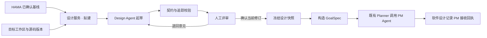

# 软件设计子系统设计说明

**职责与完成条件**　本模块把已确认 PRD 转换为指导实现的 Design Spec，经评审后提交给现有 PM Agent。PM 接收并返回与该修订一致的工作流详情和分解报告时，本次交接完成。PRD 发布、PM 分解和编排器均已有实现；下文的设计生成、设计评审、设计表与专用端点为拟建内容。

## 1. 输入与系统边界

本阶段面向任意业务领域的软件项目。用户在需求工程入口提供自己的想法、背景、约束和可选材料，HAMA 审批候选方案，再由人确认 PRD 并发布 `ApprovedRequirementsBaseline`。设计阶段读取 `prd.sections`、`prd.requirements`、`prd.trace`、`approvedPrd` 以及审批、确认记录，从本项目材料确定参与者、交付物与验收条件。目标仓库提供现有入口、技术栈和验证方式。设计者据此决定如何实现；涉及用户目标或范围变化时，需回到需求工程确认。[上游类型](../requirements-engineering/src/contracts.ts) · [基线生成](../requirements-engineering/src/pipeline.ts)

| 已有入口 | 实际行为 | 对本设计的影响 |
| --- | --- | --- |
| GET /api/hama/baselines/{baselineId} | 读取带项目、版本、模式、确认记录和摘要的完整基线 | 机器输入使用此结构；Markdown PRD 用于人工阅读 |
| POST /api/workflows/import-requirements，提交 baselineId 和 workspaceId | HAMA 拒绝 demo 基线及文档工作区，将原始需求、AC 及关联送入 importStructuredRequirements；输入和输出为空，未传模块 | 保留其身份映射与工作区限制，增加经确认的设计内容 |
| 同一路径，提交 markdown 和 workspaceId | importRequirementsSmart 解析 Markdown，结合工作区验证命令及定制参数调用 PM；保存 GoalSpec、PM 报告、图和校验结果 | 可立即使用校园案例演练；此路径新建需求内部 ID，不建立 requirementsBaseline |

实现依据见 [HAMA 交接服务](../requirements-engineering/src/service.ts)、[HTTP 路由](../workflow-orchestrator/src/server/http-router.ts) 与 [Planner](../workflow-orchestrator/src/engines/planner.ts)。

### PRD 中的信息如何转成设计

| PRD 来源 | Design Spec 需要写出的实现信息 | 核对办法 |
| --- | --- | --- |
| 背景、目标和用户场景 | 系统边界、入口、调用者和可观察输出 | 沿一个场景从触发到结果走一遍，核对成功和失败路径 |
| 功能需求、依赖和业务规则 | 负责模块、文件范围、调用契约、数据约束及其实现理由 | 每个模块引用原需求 ID；共享契约标明提供方和消费方 |
| 非功能需求、限制和范围外事项 | 具体技术选择、适用模块、质量验证条件和排除范围 | 指标沿用已确认口径，影响范围的未知项退回澄清 |
| Given/When/Then 及来源追踪 | 原始 AC、所属需求、验证方法、期望结果及设计补充检查 | 从 AC 反查原 PRD，保留条件、操作与结果三者的含义 |

例如，若 PRD 要求“统计 UTF-8 文件中非空行数，忽略纯空白行”，设计可以选定逐行读取、按去除空白后的内容判定、向标准输出写入十进制计数。前者是上游承诺，后三项是可以评审和修改的设计决定。PM 接收的模块摘要应写明这些关键决定，并关联需求编号和目标源文件；边界条件与验收方法留在完整设计正文中。

## 2. 架构与技术选择

采用与需求工程相同的同仓 TypeScript 模块，接入现有 Node 宿主和 React 工作台。设计服务负责生命周期和事务，模型只返回候选内容。复用已配置的模型提供商和无工具文本调用，便于对输出做结构校验。存储采用宿主 SQLite，便于把确认决定、冻结快照和本地交接关联放入事务。保留 Markdown 渲染件用于课堂展示及人工评审，结构化快照作为机器交接依据。[模型调用实现](../requirements-engineering/src/agents.ts) · [宿主装配](../workflow-orchestrator/src/server/runtime.ts) · [工作流存储](../workflow-orchestrator/src/store/database.ts)

| 拟建模块 | 读取 | 输出与责任 |
| --- | --- | --- |
| 基线与工作区适配 | baselineId、workspaceId、目标提交标识 | 校验模式和归属，提取范围、依赖、规则及原始编号。清点目标源码目录、已用技术、可运行的验证命令，分别标记现有和拟新增路径 |
| 设计生成 | 基线快照、源码清单、上一版评审意见 | Design Agent 输出模块、接口、数据设计、备选决策与理由。每个模块声明所属层、文件范围和需求引用，缺失事实进入待确认项 |
| 设计校验与评审 | 草案及原始 PRD | 程序检查编号、归属、范围覆盖和工件完整性；开发、质量等评审人检查语义、可实现性和可验证性，决定退回或确认 |
| 版本库与渲染 | 结构化正文、决定记录 | 保存每次修订和决定，生成与该修订一致的评审稿和 PM 输入，历史确认版可再现 |
| PM 交接适配 | 已确认修订、同一目标工作区 | 生成 GoalSpec，调用现有结构化规划入口，保存设计修订到 workflowId 的关联，展示实际校验结果 |

## 3. 数据设计

以下为拟建的最小持久化模型。一个需求基线可以在不同目标仓库上形成不同设计；同一设计系列内按修订号追加正文。评审、批准和下游导入均指向具体修订。

| 记录 | 字段与约束 |
| --- | --- |
| design_revisions | 主键 (designId, revision)；记录 parentRevision、baselineId、projectId、baselineRevision、baselineSha256、workspaceId、sourceCommit、schemaVersion、bodyJson、contentSha256、state、createdAt。摘要覆盖来源引用、目标版本及规范化正文，排除可变状态和决定记录 |
| design_decisions | decisionId、designId、revision、expectedHash、actor、action、findings、decidedAt；每条发现含对象、严重度、依据、处理结果。确认事务必须匹配待审修订及其摘要 |
| design_handoffs | (designId, revision, workspaceId) 唯一，保存 workflowId、contentSha256、pmReportId、status、diagnostics、完整首次 receipt 和 createdAt；外键及触发器指向确认修订、匹配的工作区和已创建工作流 |

正文含目标、输入输出、约束、领域规则、模块、接口、数据实体、追踪、验收方法、决策和假设。模块复用 `DesignSpecModule` 的六种 layer 取值（contract、backend、frontend、data、security、integration）。接口按“调用者、操作、输入、输出、失败语义”记录；持久化实体按“标识、唯一性、生命周期、事务边界”记录。每条追踪记录保存原始 requirementId、acceptanceIds、模块引用和验证方法。设计额外推导的检查单独标记来源，避免伪造上游验收编号。[下游类型](../workflow-orchestrator/src/shared/types.ts)

步骤 4 已将额外检查实现为可选 `designChecks`：DC 编号、来源决策 / 接口 / 质量要求、关联需求与模块、验证方法及证据。该字段参与设计摘要和确认稿，旧确认快照不补写默认值。确认后可通过 `GET /api/designs/{id}/revisions/{rev}/pm-input?expectedHash=…` 查看纯映射结果；原始 AC 与设计检查分开保存，接口不创建工作流。实现及验证见[步骤 4 记录](./verify/step4-verification.md)。

接口可以是函数、命令行、文件格式、事件或网络服务。数据可以只在一次进程执行期间存在。按需求记录适用的契约；无持久化的工具说明输入输出及生命周期即可。宿主采用的 TypeScript、React 和 SQLite 服务于工作台。目标应用的技术选型由其基线约束、已有依赖及可验证的取舍决定。新项目可从仅含初始提交的工作区起步，文件范围标为拟新增。尚无 Git 提交时先形成概念设计，绑定可复现的工作区版本后进入正式评审与交接。

## 4. 拟建接口与流转

沿用宿主回环 HTTP 和 Bearer Token。actor 沿用本地操作员填写的审计身份。以下路径是实现提案，可据此划分前后端工作。

| 操作 | 请求与成功返回 | 关键失败语义 |
| --- | --- | --- |
| POST /api/designs | baselineId、workspaceId、sourceCommit；生成并校验成功后返回 201 和草案引用 (designId, revision, hash) | 来源或工作区未知返回 404；源码版本不匹配返回 409；生成失败保留失败原因供重试 |
| GET /api/designs/{id}/revisions/{rev} | 返回完整来源、正文、校验结果、决定及可用交接记录 | 修订不存在返回 404 |
| POST /api/designs/{id}/revisions/{rev}/review | 提交 expectedHash、actor、action、findings；submit 发起评审，request_changes 退回，confirm 冻结 | 旧摘要或状态冲突返回 409；存在阻断意见或覆盖缺口返回 422 |
| POST /api/designs/{id}/revisions | 提交父修订、expectedHash 和修改内容或再生成意见，返回新草案引用 | 修改对象已过期返回 409；跨基线修改需另建以新基线为来源的设计 |
| POST /api/designs/{id}/revisions/{rev}/handoff | 提交 workspaceId、expectedHash；首次创建返回 201 和 workflowId，重复成功请求返回 200 及原 workflowId | demo、文档工作区、未确认、目标不符或源码已漂移时停止交接，并返回具体原因 |

草案经过结构校验后可从 draft 转为 in_review。退回时记录 changes_requested 和逐项意见，新修订重新送审；确认时以条件更新将 in_review 转为 confirmed。确认快照只读，后续修订记录父版本及变更原因。若基线发生变化，先按稳定需求和 AC 标识对比新增、修改与删除项，再检查依赖模块和验证用例，针对新基线重新评审。旧设计仍对应原基线。

### 向已实现的 PM Agent 提交

正式交接适配器使用已有宿主方法 `WorkflowPlannerEngine.importStructuredRequirements(workspaceId, source)`，其中 `source` 的类型是 `Omit<GoalSpec, 'id' | 'workflowId' | 'updatedAt'>`。Planner 分配这三个字段，以 supervised 权限调用 `PmAgentDecomposer.decomposeStructural`，保存结果并返回 `WorkflowDetailSnapshot`。设计端只需实现从确认稿到 source 的映射及交接记录。[Planner 入口](../workflow-orchestrator/src/engines/planner.ts) · [PM Agent](../workflow-orchestrator/src/engines/pm-agent.ts) · [返回类型](../workflow-orchestrator/src/shared/api.ts)

| 传入现有 Planner 的字段 | 转换规则 |
| --- | --- |
| rawMarkdown、title、goal | 传入本次确认的完整 Design Spec 正文、标题及目标 |
| requirementsBaseline、requirements、acceptanceCriteria | 保留基线 id、projectId、revision、sha256。将 PRD 需求 id 同时用作目标 id 和 code，将原 AC id 同时用作 AC id 和 code 并填写所属 requirementId。must 映为 must，should/could 映为 should，原优先级保留在快照；verified 初值为 false |
| modules | 传入 name、layer、summary、artifacts、relatedFrCodes。摘要写入重要契约和依赖，路径相对目标仓库，引用使用原需求 code（含 NFR）。当前类型不含独立的接口或依赖边字段，完整接口、数据与决策保存在正文 |
| inputs、outputs、constraints、domainRules、assumptions | 从同一确认修订取值。对原 PRD 的约束、规则与设计推定保留来源差异，未确认且影响范围的问题先交还上游 |

**接收证据**　先比较返回的 goalSpec.rawMarkdown、requirementsBaseline、原需求与 AC 引用，再核对 pmReport 非空、pmReport.workflowId 等于 workflow.id、detectedModules 与提交模块一致。记录设计修订、摘要、workflow.id 和 pmReport.id。PM 可按并行上限合并模块，应核对 slices 的需求与文件覆盖。工作流图的校验状态随回执展示，由编排器继续处理。

步骤 5 已将现有 Planner 的工作流落库与 design_handoffs 插入置于同一宿主 `BEGIN IMMEDIATE` 事务，结构化导入支持延后广播，外层 COMMIT 后才发布更新；重试先查唯一键。并发提交、客户端响应丢失或服务重启后均可取回同一工作流及原始回执。待核查记录按原键重新检查报告，不再创建工作流；已签收回执保持只读。草案图未通过编排校验时保留其 draft 状态和报告。接口、源码复核、故障回滚及验收证据见[步骤 5 记录](./verify/step5-verification.md)。

## 5. 评审和验收

| 检查 | 通过条件 | 失败处理 |
| --- | --- | --- |
| 范围和追踪 | 每条 FR/NFR 都有负责模块，每个基线 AC 都有验证方法，所有引用能反查至同版 PRD | 列出缺失和悬空的 ID，退回设计修订 |
| 契约与失败处理 | 逐一核对实际边界的输入、输出、错误与副作用；涉及共享状态时补查重复操作、并发和中断后的状态 | 记录可复现的反例及受影响的验收条件，退回相应模块 |
| 实现边界 | 模块路径落在目标工作区，新增路径标识明确，重叠写入有明确归属；关键外部依赖有核实结果 | 路径和技术假设由目标工程负责人确认，再提交评审 |
| 冻结与返工 | 对旧摘要提交确认被拒；退回后可读取旧版、新版和逐项处理意见 | 重新读取当前版本，禁止将旧决定套用到新版 |
| PM 接收 | 原需求及 AC 关联完整，确认稿与回读正文一致，PM 报告可定位同一工作流和设计模块；重复交接返回原结果 | 定位到输入映射、交接关联或下游报告，保留原修订和诊断 |

评审保存所审版本及摘要、评审人、结论、意见和复核证据。需求基线、确认稿与 PM 接收报告构成本阶段的验收材料。
